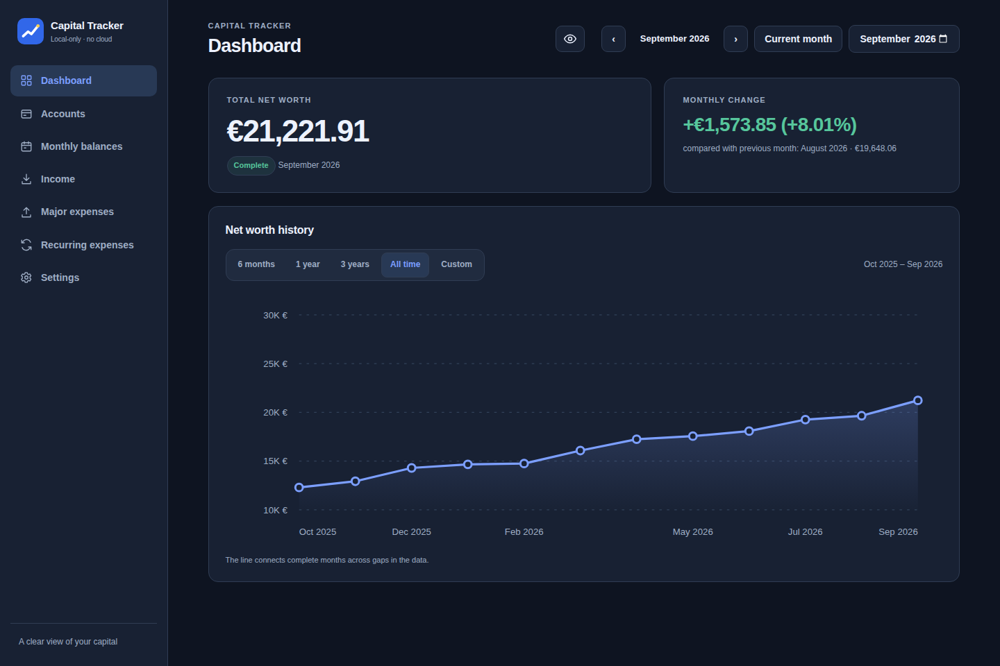
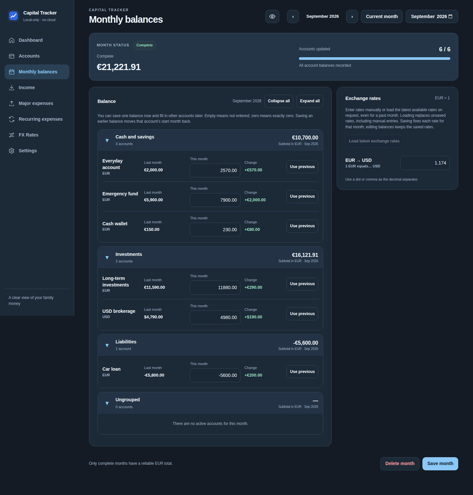
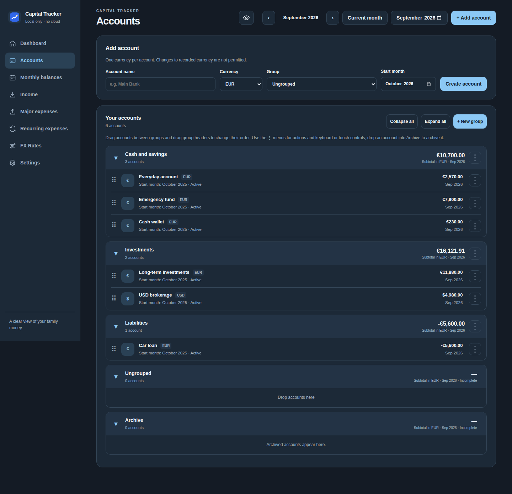
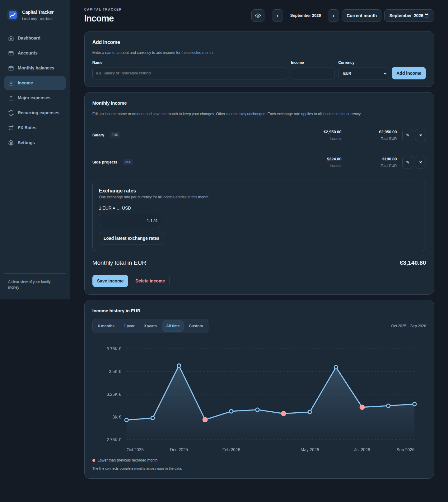
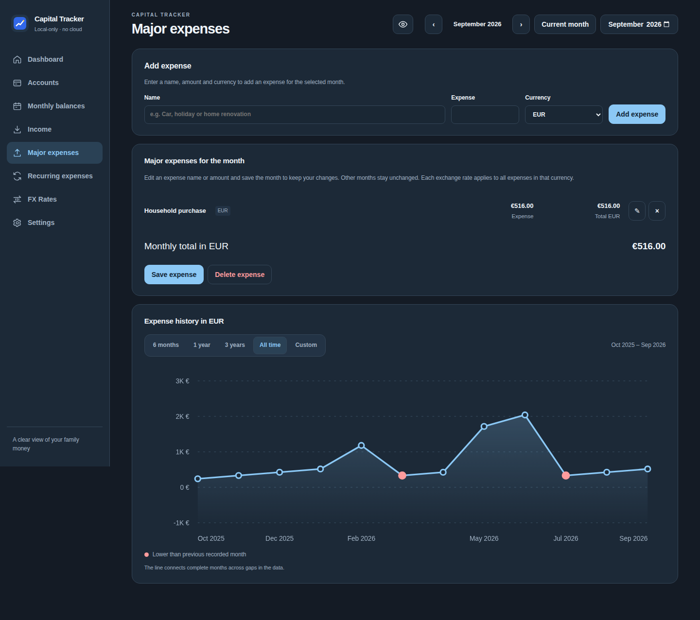
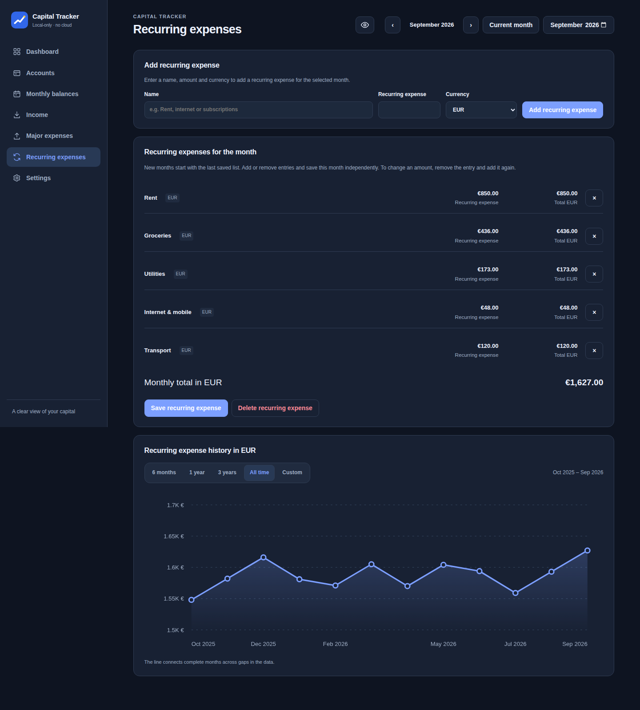
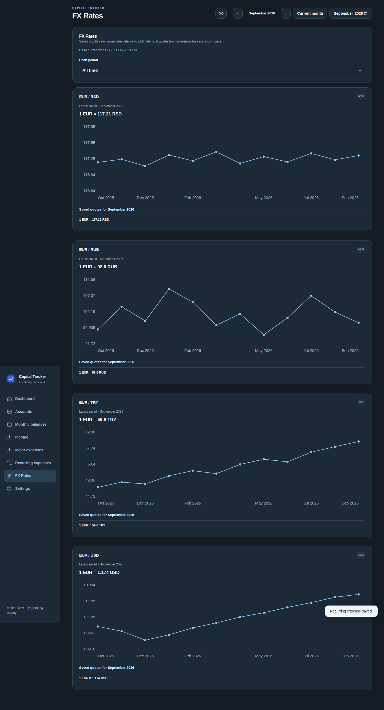
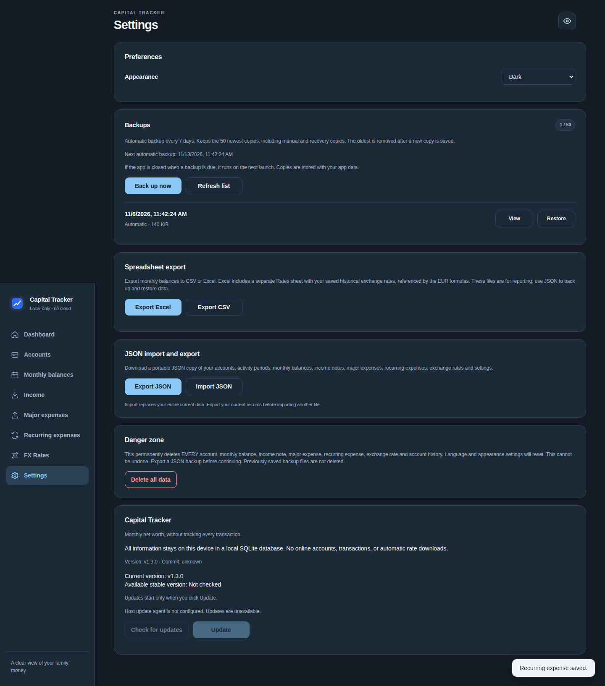
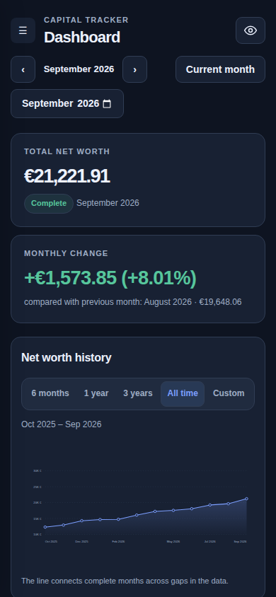
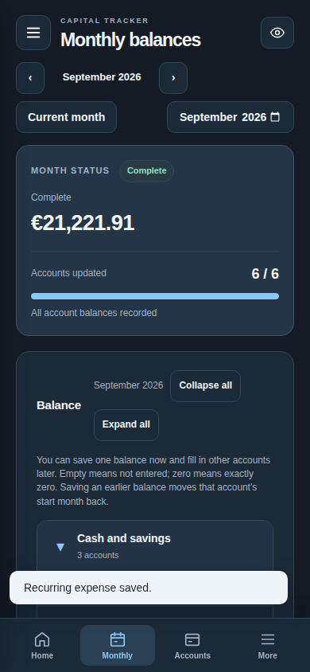

<div align="center">

<a href="https://github.com/perevozchiko/capital-tracker">
  
</a>

<h1>Capital Tracker</h1>

<p><strong>Know what you own. Track how it grows.</strong></p>

<p>A lightweight, local-first net-worth tracker<br>Update your account balances once a month — without recording every purchase.</p>

<p><a href="#screenshots">Explore screenshots</a> · <a href="#quick-start">Quick start</a> · <a href="#downloads">Downloads</a> · <a href="#documentation">Documentation</a></p>

<a href="https://github.com/perevozchiko/capital-tracker/actions/workflows/ci.yml">
  
</a>
<a href="LICENSE"></a>
<a href="https://github.com/perevozchiko/capital-tracker/releases"></a>

<p><strong>Go + SQLite</strong> · <strong>No mandatory cloud or account</strong> · <strong>Local data</strong> · <strong>macOS / Linux / Windows</strong></p>

</div>

Capital Tracker is independently developed open-source software, not affiliated with any commercial budgeting app. Your balances and notes live in your own SQLite database. Run it locally with no sign-in, or optionally self-host it behind HTTPS with password-protected access and TOTP confirmation for new devices.

## Screenshots

<p align="center"><strong>Real Chromium captures from the current app (November 2026) — not renders or mockups.</strong><br>
Dark theme · isolated, fictional 12-month demo · October 2025–September 2026.<br>
Click any image to open the original full-size PNG.</p>

<div align="center">

### Dashboard

<a href="https://raw.githubusercontent.com/perevozchiko/capital-tracker/master/docs/screenshots/dashboard.png">
  
</a>

<sub>Net worth at a glance, with an accurate month-to-month comparison and capital history.</sub>

</div>

<table>
  <tr><th width="50%">Monthly balances</th><th width="50%">Accounts &amp; groups</th></tr>
  <tr>
    <td align="center"><a href="https://raw.githubusercontent.com/perevozchiko/capital-tracker/master/docs/screenshots/monthly-balances.png"></a></td>
    <td align="center"><a href="https://raw.githubusercontent.com/perevozchiko/capital-tracker/master/docs/screenshots/accounts.png"></a></td>
  </tr>
  <tr>
    <td align="center"><sub>Update just one account or several, with last month's value beside each entry.</sub></td>
    <td align="center"><sub>Arrange accounts by dragging, collapse sections and keep archived history.</sub></td>
  </tr>
</table>

<table>
  <tr><th width="50%">Income</th><th width="50%">Major expenses</th></tr>
  <tr>
    <td align="center"><a href="https://raw.githubusercontent.com/perevozchiko/capital-tracker/master/docs/screenshots/income.png"></a></td>
    <td align="center"><a href="https://raw.githubusercontent.com/perevozchiko/capital-tracker/master/docs/screenshots/major-expenses.png"></a></td>
  </tr>
  <tr>
    <td align="center"><sub>Track salary, side income and other sources separately from account balances.</sub></td>
    <td align="center"><sub>Record noteworthy purchases without keeping a transaction ledger.</sub></td>
  </tr>
</table>

<div align="center">

### Recurring expenses

<a href="https://raw.githubusercontent.com/perevozchiko/capital-tracker/master/docs/screenshots/recurring-expenses.png">
  
</a>

<sub>Organize rent, utilities and other recurring costs into reorderable groups with EUR subtotals; unsaved months inherit the previous saved snapshot.</sub>

### Currency history and exports

<table>
  <tr><th width="50%">Historical exchange rates</th><th width="50%">Data exports and backups</th></tr>
  <tr>
    <td align="center"><a href="https://raw.githubusercontent.com/perevozchiko/capital-tracker/master/docs/screenshots/fx-history.png"></a></td>
    <td align="center"><a href="https://raw.githubusercontent.com/perevozchiko/capital-tracker/master/docs/screenshots/settings.png"></a></td>
  </tr>
  <tr>
    <td align="center"><sub>Inspect the rates saved with your months, not today's live quotes.</sub></td>
    <td align="center"><sub>Download CSV or linked Excel reports; keep portable JSON and local SQLite backups.</sub></td>
  </tr>
</table>

### Mobile

<table>
  <tr><th width="50%">Dashboard</th><th width="50%">Monthly balances</th></tr>
  <tr>
    <td align="center"><a href="https://raw.githubusercontent.com/perevozchiko/capital-tracker/master/docs/screenshots/mobile-dashboard.png"></a></td>
    <td align="center"><a href="https://raw.githubusercontent.com/perevozchiko/capital-tracker/master/docs/screenshots/mobile-balances.png"></a></td>
  </tr>
</table>

<sub>Both captures use a real 390-pixel browser viewport, not a scaled desktop screenshot. The mobile layout has bottom tabs plus a swipeable navigation drawer.</sub>

<p><a href="docs/screenshots/README.md">Open the full screenshot gallery &amp; regeneration instructions</a></p>

</div>

## What it does

- **Monthly net-worth snapshots:** update balances once a month, not every transaction. Add one account now and fill in the rest later; a missing balance is not zero.
- **Accounts & groups:** keep bank, cash, investment and loan accounts in expandable groups with EUR subtotals. Drag accounts between groups, reorder them and archive without erasing history. Monthly balances show the same group order while keeping balances editable.
- **Five currencies & FX history:** EUR is the reporting base, with USD, RSD, RUB and TRY. Enter month-specific rates or explicitly fetch quotes. Saved rates remain attached to their months; a separate Exchange rates screen charts the recorded history without repricing past balances.
- **Monthly review dashboard:** EUR net worth, a previous-month comparison, income/expense summaries, group subtotals, a history chart and a four-part checklist for balances, income, major expenses and recurring expenses. Missing entries are shown as needing review.
- **Income:** named sources such as salary and freelance work in their original currencies. Edit a recorded entry, view EUR equivalents and monthly income history, and retain each month's saved rates.
- **Major expenses:** record and edit occasional large purchases with names, currencies, EUR totals and a separate history chart, without changing saved account balances.
- **Recurring expense groups:** organize regular costs into named, collapsible groups, reorder groups or items by drag-and-drop, and see EUR subtotals. An unsaved month inherits the latest earlier saved snapshot; saving freezes that month's list and groups.
- **Exports & backups:** export a flat CSV balance table or an Excel (.xlsx) workbook whose Balances formulas reference the saved monthly Rates sheet. JSON import/export preserves application data; the import replaces existing data. Automatic weekly SQLite backups retain the newest 50 copies, with read-only browsing and recoverable restores. Optional HTTPS self-hosting supports single-user login and revocable sessions.
- **Responsive, privacy-first PWA:** redesigned desktop cards, mobile bottom tabs and a swipeable menu. Amounts start hidden on each page load; tap the eye to reveal them. Dark/Light/System themes are available. Stored money uses integer minor units and exact fixed-point FX rates.

Income, major expenses and recurring expenses are **independent notes**, not bank transactions. They do not automatically change account balances or net worth.

## Quick start

Install [Go](https://go.dev/dl/) 1.27.3 or newer, then clone this repository and run:

```sh
go run ./cmd/capital-tracker --demo
```

The app opens at **http://127.0.0.1:8765** in your default browser. Demo mode writes exclusively to a separate `CapitalTrackerDemo` directory. Your normal data is never loaded or replaced by the demo.

To start with your actual accounts, run without `--demo`:

```sh
go run ./cmd/capital-tracker
```

Or create a standalone executable:

```sh
go build -o CapitalTracker ./cmd/capital-tracker
./CapitalTracker
```

On Windows, use `-o CapitalTracker.exe` and run `CapitalTracker.exe`.

The executable bundles the web interface and uses only a local HTTP server. It has no production Node.js dependency. The server binds loopback only; for password-protected access from computers and phones through `https://fin.anasko.net`, see [Hosting](docs/HOSTING.md).

<details>
<summary><strong>What is included in the demo?</strong></summary>

The isolated fictional sample contains 12 complete monthly snapshots (October 2025–September 2026), with fictional account balances, EUR/USD rates, savings, investments, a loan, named income, major expenses and regular expenses. Demo mode never opens or edits your regular database. See the [User Guide](docs/USER_GUIDE.md) for details.

</details>

<details>
<summary><strong>How private is the app?</strong></summary>

The app binds only to the local loopback interface, does not require an online account, and stores financial data in local SQLite. Optional exchange-rate lookups require an explicit user action and do not send your account balances to the provider. Self-hosted access can use password-protected HTTPS through your own reverse proxy; this is optional and requires setup. The SQLite database and exported JSON are not encrypted by the application; use full-disk encryption and backups for protection. See [Security](SECURITY.md).

</details>

<details>
<summary><strong>What is the difference between CSV, Excel and JSON exports?</strong></summary>

**CSV** is a flat, read-only list of recorded account balances. **Excel (.xlsx)** includes separate Balances and Rates sheets, with formulas linking each balance to its saved monthly exchange rate. **JSON** is the full application snapshot for backup/migration and is the only format you can import back into Capital Tracker. Neither CSV nor Excel import is supported.

</details>

## Downloads

- [**Releases**](https://github.com/perevozchiko/capital-tracker/releases) — manually published versioned packages for macOS (Apple Silicon and Intel), Windows x64 and Linux x64 when a release has been published.
- [**Actions → Build Capital Tracker**](https://github.com/perevozchiko/capital-tracker/actions/workflows/build-macos.yml) — manually build a development binary for macOS Apple Silicon, Windows x64, Linux x64, or all three; no release is created.
- [**Actions → Release**](https://github.com/perevozchiko/capital-tracker/actions/workflows/release.yml) — manual SemVer release workflow, supporting Alpha, Beta, RC and Stable.

Downloaded binaries are currently unsigned/not notarized. Verify the attached SHA-256 checksums. Existing data is kept separately from application binaries.

## Documentation

| Guide | Contents |
| --- | --- |
| [User Guide](docs/USER_GUIDE.md) | Demo, groups, balances, income and expense notes, rates, backups and financial rules |
| [Self-hosting](docs/HOSTING.md) | Optional single-user login, systemd service and HTTPS reverse proxy |
| [Architecture](docs/ARCHITECTURE.md) | Go and browser modules, data flow, SQLite migrations, exact-money invariants, security |
| [Application updates](docs/UPDATES.md) | Explicit update button, macOS/OrbStack host agent, protected IPC and installation contract |
| [HTTP API](docs/API.md) | Endpoint list, JSON payloads, errors and same-origin requirements |
| [Development and releases](docs/DEVELOPMENT.md) | Build/run options, formatting, unit and browser tests, GitHub Actions, release versions |
| [Browser test coverage](docs/TEST_COVERAGE.md) | Scenario matrix, drag-and-drop, group visibility, large mobile balances, history persistence and live currency-provider checks |
| [Contributing](CONTRIBUTING.md) | Project conventions, local checks and pull requests |
| [Security](SECURITY.md) | Threat model, local data protection and vulnerability reporting |

## Development checks

Node.js 22+ is used **only for development** (Playwright and Prettier).

```sh
npm ci
npm run check
npx playwright install chromium
npm run test:ui
```

The browser suite covers Chromium and WebKit (Chrome and Safari engines), covering accounts/groups, income and expenses, recurring-month inheritance, authentication, drag-and-drop, financial boundaries and workflows through restart, export, deletion and import. Mobile layout scenarios check large values in all five currencies, clipping, overlap and account history table visibility; they also save screenshots.

Browser tests use fresh isolated temporary databases, not your personal data. The external-provider scenario is skipped by default. To also exercise real quote loading through the browser and verify that the loaded rates are saved exactly:

```sh
CAPITAL_TRACKER_LIVE_RATES=1 npm run test:ui -- --workers=4
```

To regenerate all ten real browser screenshots on a fresh isolated demo, run `python3 scripts/capture-demo-screenshots.py` after installing Python Playwright and Chromium, or use the manual screenshot GitHub Action. See [screenshot instructions](docs/screenshots/README.md).

See the [coverage matrix](docs/TEST_COVERAGE.md) for the scenario breakdown. `npm run format` formats Go and frontend sources; see the [Development guide](docs/DEVELOPMENT.md) for details.

## License

Copyright © 2026 **perevozchiko**.

Licensed under **MIT OR Apache-2.0**, at your choice. Read the complete [MIT License](LICENSE) and [Apache License 2.0](LICENSE-APACHE). You may use, modify and redistribute the original application source, including commercially, subject to the terms of the chosen license. Third-party dependencies remain under their own licenses.

This project is provided **as is**, without warranty. It is a personal finance tracking tool, not financial advice.
