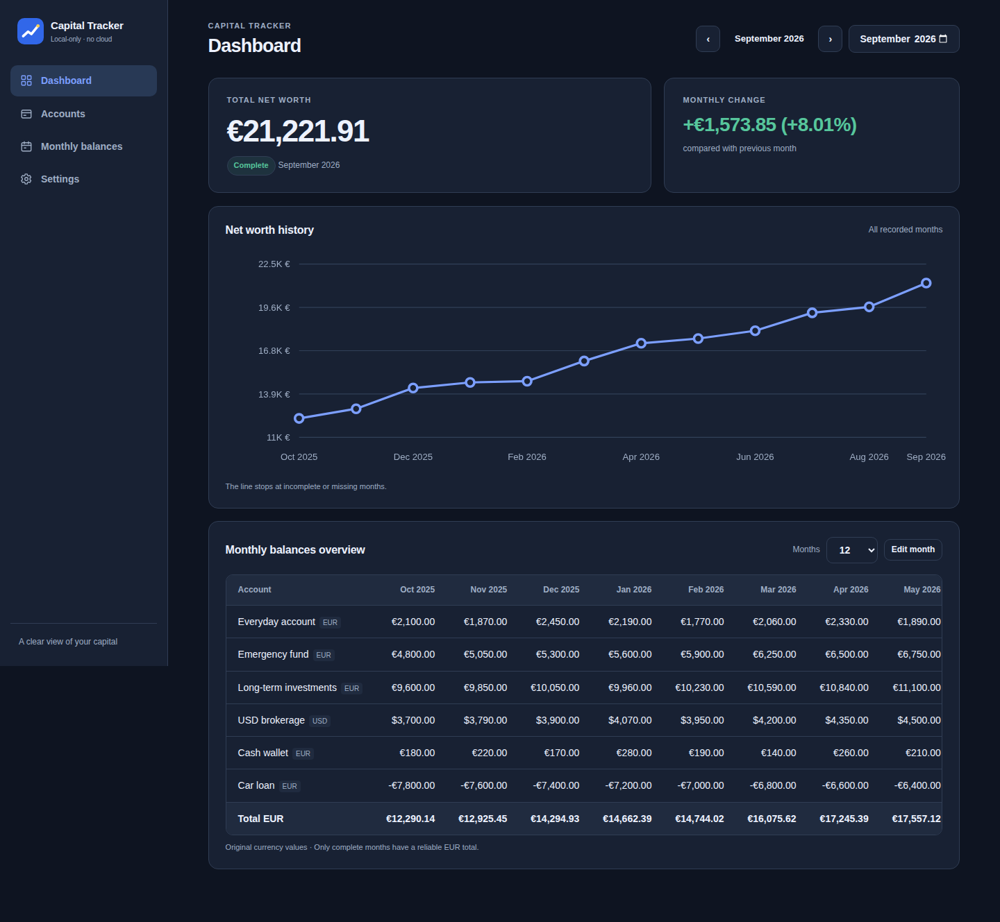
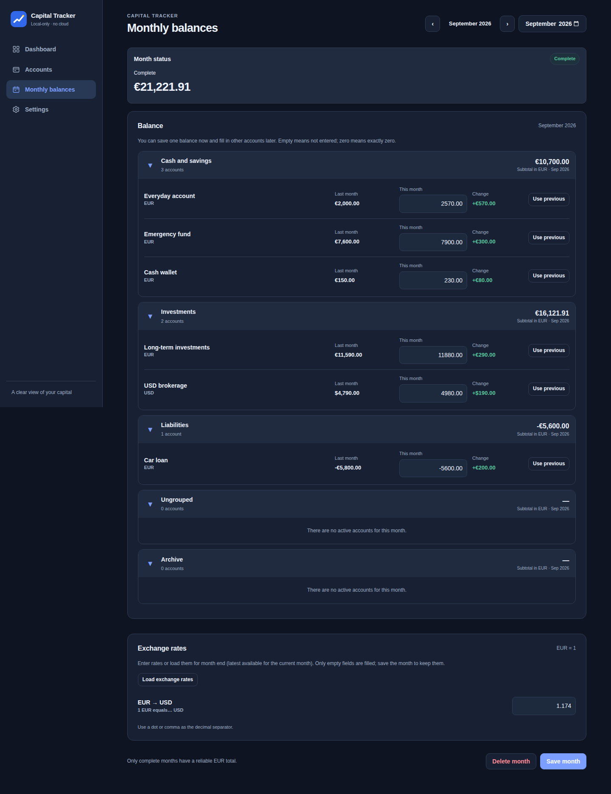
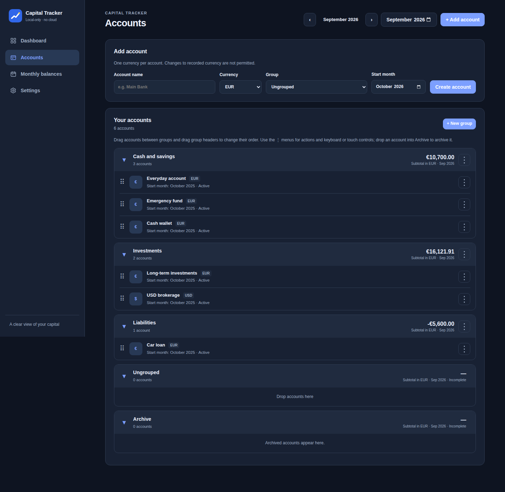

# Capital Tracker

A simple, local-first personal net worth tracker. Record end-of-month balances instead of individual transactions, and monitor total capital converted to EUR using **the exchange rate saved for each month**.

- Five account currencies: EUR, USD, RSD, RUB and TRY.
- Multiple independent accounts, **collapsible and reorderable groups**, drag-and-drop account organization, archived history, monthly balances and monthly FX rates entered manually or loaded on request.
- Exact arithmetic, no binary floating point in stored balances or exchange rates.
- Dashboard with adjustable 6–120 adjacent month columns (12 by default), monthly change and historical SVG chart.
- English interface, **Dark theme by default**, with optional Light / System modes; responsive browser UI and PWA assets.
- A single local HTTP server with embedded assets; no cloud, login, frontend build, Node.js or bank connection.
- Optional isolated `--demo` mode with a realistic fictional year of data.

## Demo mode — a year of example finances

To explore the app with populated screens, start it with **`--demo`**:

```sh
go run ./cmd/capital-tracker --demo
```

If you have already built the executable, use `./CapitalTracker --demo` (or `CapitalTracker.exe --demo` on Windows). The browser opens at **http://127.0.0.1:8765**. If your normal instance is already using that port, choose another:

```sh
go run ./cmd/capital-tracker --demo --port 8766
```

**Demo mode never opens or changes your regular Capital Tracker database.** It uses a separate directory called `CapitalTrackerDemo` next to the regular `CapitalTracker` data directory. Normal `--data-dir` / `CAPITAL_TRACKER_DATA_DIR` overrides are deliberately ignored when `--demo` is selected. The sample is installed only if the demo database is completely empty, so edits made during a demo session remain in place when you restart it. To restore the original fixture, stop the demo and delete only the `CapitalTrackerDemo` folder, then launch with `--demo` again. Alternatively, use Settings → Danger zone → Delete all data while in demo mode, and restart.

The included fictional example represents a typical euro-paid working household, **not actual financial records or official statistical averages**. It contains **12 complete end-of-month snapshots, October 2025 through September 2026**, with six accounts arranged in three groups (Cash and savings, Investments, Liabilities): EUR everyday checking, emergency savings, long-term investments, USD brokerage holdings, EUR cash, and a negative EUR car-loan balance. Fluctuating balances suggest a take-home pay around €2,800 per month, ordinary living expenses, savings, a summer holiday and gradual loan repayment; those earnings/expenses are *context only* and are not logged as transactions. Each month has its own example EUR/USD rate. Navigate between **Dashboard**, **Accounts** and **Monthly balances** to inspect the history and try editing a month.

The example is also provided as a fully importable, versioned JSON snapshot in [`internal/demo/sample-2025-2026.json`](internal/demo/sample-2025-2026.json). You can import it via **Settings → JSON import and export** if desired, but **import replaces the currently open database**. For safe exploration, prefer `--demo`.

## Screenshots — real browser captures (dark theme)

The default appearance is **Dark**, including the included demo data and after clearing the app. Users can still explicitly select Light or System under Settings, and previously saved theme preferences are preserved.

<!-- AUTO SCREENSHOTS START -->

### Dashboard



### Monthly balances



### Accounts



<!-- AUTO SCREENSHOTS END -->

To capture the same screenshots on your machine:

```sh
python3 -m pip install playwright
python3 -m playwright install chromium
python3 scripts/capture-demo-screenshots.py
```

The script builds and starts Capital Tracker with a temporary isolated demo database, opens Chromium, selects **Dark** in the actual Settings screen and saves full-page PNG images as `docs/screenshots/dashboard.png`, `docs/screenshots/monthly-balances.png` and `docs/screenshots/accounts.png`. No personal database is opened or modified. Browser and Python dependencies are required only for screenshots, not for normal app use.

On GitHub, open **Actions → Capture demo screenshots → Run workflow**, choosing `master`. This manual-only workflow captures the images and commits the three PNGs and README update to the repository. Regular pushes and commits do **not** trigger it.


## Release Process

Versioned releases are deliberately manual. Open **Actions → Release → Run workflow**, choose `master`, select the **Version increment** (`current`, `patch`, `minor` or `major`) and **Release stage** (`alpha`, `beta`, `rc` or `stable`), then click **Run workflow**. After success, find the archives under [GitHub Releases](https://github.com/perevozchiko/capital-tracker/releases). Regular commits and merges run CI checks but never create version tags or publish releases. The separate **Build Capital Tracker** workflow remains manually runnable on development branches and can build macOS, Linux, Windows or all platforms.

The authoritative application version is the Go constant in `internal/buildinfo/buildinfo.go`. The workflow fetches Git tags to prevent collisions, prepares the next version commit (only if needed), validates and builds a **pinned commit**, verifies four release archives and their SHA256 checksums, and only after all required jobs pass creates the immutable version tag and GitHub Release. A failed test or build prevents publishing. If a version preparation commit succeeded but no tag was published, rerun **Current** with the same release stage to retry that exact version.

**Current** continues the MAJOR.MINOR.PATCH series: the selected prerelease stage increments automatically (`alpha.2 → alpha.3`), and advancing `alpha → beta → rc → stable` keeps the base version and resets numbering to `.1` for the new prerelease stage. Downgrading to an earlier stage of the same series is rejected. **Patch** increments PATCH; **Minor** increments MINOR and resets PATCH; **Major** increments MAJOR and resets MINOR and PATCH. For a new series, select any stage. For example, starting at `v0.1.3`, choose **Patch + Alpha** for `v0.1.4-alpha.1`. With no existing release tag, **Current + Stable** can publish the existing `v0.1.3`; **Current + Alpha** is correctly rejected because it would downgrade an already stable version.

Each release includes `CapitalTracker-vX.Y.Z[-stage.N]-macos-arm64.zip`, `...-macos-amd64.zip`, `...-linux-amd64.tar.gz` and `...-windows-amd64.zip`, plus individual `.sha256` files. GitHub automatically generates release notes using `.github/release.yml` (categorized merged PRs, contributors and comparison link); Alpha, Beta and RC are prereleases while Stable is not. **Settings → About** displays the authoritative version and 8-character build commit; `CapitalTracker --version` reports the same information without opening a server or requiring Git. Release packages are not code-signed.

## Build and run

Install Go and build (Go 1.23 or later; GitHub Actions uses Go 1.27.3):

```sh
go mod tidy
go test ./...
go vet ./...
go build -o CapitalTracker ./cmd/capital-tracker
./CapitalTracker
```

On Windows, replace `-o CapitalTracker` with `-o CapitalTracker.exe`, and launch `CapitalTracker.exe`.

The server listens on **http://127.0.0.1:8765**, opens the default browser once ready, and runs until you close the terminal or press Ctrl+C. The app only serves on the local machine; opening the URL on your phone will *not* connect to the computer. Its mobile-size UI can be tested in browser responsive device mode.

Options:

```sh
./CapitalTracker --no-browser
./CapitalTracker --port 8766 --data-dir /some/private/directory
CAPITAL_TRACKER_PORT=8766 CAPITAL_TRACKER_DATA_DIR=/some/private/directory ./CapitalTracker
./CapitalTracker backup /some/other/directory/backup.db
./CapitalTracker backup --data-dir /some/private/directory /some/other/directory/backup.db
```

Command line options override environment variables, which override defaults. The `backup` subcommand accepts `--data-dir` and the environment data directory and safely takes a consistent snapshot with SQLite `VACUUM INTO`; it refuses to replace an existing destination. Do not copy `capital.db` alone while the server is running: SQLite can keep live changes in `capital.db-wal`. Shut down the program before making manual filesystem backups, or use `backup` while it runs.

Data location: macOS `~/Library/Application Support/CapitalTracker/capital.db`; Linux `${XDG_CONFIG_HOME:-~/.config}/CapitalTracker/capital.db` and Windows the standard user configuration directory. Your data is not bundled with the executable; replacing the executable will not delete your records.

The executable is not Apple-signed/notarized; Gatekeeper may warn when launching a downloaded binary. Build locally or follow Apple's standard security confirmation procedure for software you trust.

## Download builds from GitHub Actions

Run all local source checks before committing (requires Go 1.23+ and Node.js 22+):
```sh
npm ci
npm run check
```
Browser UI tests exercise the real application in headless Chromium with an isolated temporary database per test. Install Node.js 22 or newer, Go, and the browser once, then run:

```sh
npm ci
npx playwright install chromium
npm run test:ui
```

The suite covers navigation, settings, account and group management, monthly balances, exchange-rate loading (with deterministic mocked responses), import/export, deletion confirmations, and a mobile viewport. Test failures retain Playwright traces under `test-results/`; view one with `npx playwright show-trace <path-to-trace.zip>`. The tests do not use the normal application database. GitHub Actions runs them on pushes and pull requests.

If it reports Go formatting differences, run `gofmt -w .` once and commit the formatted files. The script checks `gofmt`, `go mod tidy -diff`, `go mod verify`, `go vet`, Go tests, syntax for every JavaScript module, JavaScript unit tests and Prettier formatting. The check command never changes source files. Use `npm run format` to format Go, JavaScript, CSS and HTML sources.

**Builds are manual-only** during development: pushes, tags, and pull requests do not trigger compilation.

To request a binary, open **Actions → Build Capital Tracker → Run workflow**, select the `master` branch, and choose a `platform`:

| Selection | Runner | Downloadable artifact | Executable |
| --- | --- | --- | --- |
| `macos` (default) | macOS Apple Silicon (ARM64) | `CapitalTracker-macos-arm64` | `CapitalTracker-darwin-arm64` |
| `linux` | Linux x86-64 (AMD64) | `CapitalTracker-linux-amd64` | `CapitalTracker-linux-amd64` |
| `windows` | Windows x86-64 (AMD64) | `CapitalTracker-windows-amd64` | `CapitalTracker-windows-amd64.exe` |
| `all` | All three | All three artifacts | One per platform |

Each selected job runs unit tests, JavaScript checks, `go vet`, and a native build. The macOS job additionally smoke-tests the server, the home page, backup, and restart. After a successful run, download your artifact from that run's **Artifacts** section. Each artifact includes a SHA-256 checksum. macOS Intel is not built; downloaded binaries are unsigned/unnotarized, and GitHub Releases are not published automatically.

## Account groups

On **Accounts**, choose **New group** to create named sections such as Cash and savings, Investments and Loans. The group name is unique (case-insensitive). Each group has a header that can be expanded/collapsed, renamed, moved up/down with buttons or reordered by dragging the header. The collapsed/expanded state persists in this browser.

Accounts can be placed in a group as soon as they are created. Existing accounts can be dragged onto another account or group header, or assigned using the group selector next to each account (keyboard and touch alternative). Arrow buttons still reorder accounts inside their groups. An always-visible **Ungrouped** section receives unassigned accounts and accepts dropped accounts.

Each group header displays its **exact EUR subtotal** for the selected month (which can be switched at the top of Accounts). Group subtotals use the exchange rates saved for that particular month, include negative balances, and use the same exact rational arithmetic as the main net worth total. If any account active in that group lacks a balance or necessary rate for the selected month, its subtotal is **not displayed as zero**: the group is marked incomplete. Archived accounts stay visible but are not included in months when they are inactive. Individual group amounts are rounded once per group; due to rounding, the sum of rounded group subtotals can differ by one or more cents from the main once-rounded total.

Group membership is **organizational and current**, not a historical dimension: moving a previously recorded account changes which group's past-month subtotal includes its balances, but never changes the account history or the overall monthly net worth. Deleting a group only moves its accounts to **Ungrouped**; it does not delete accounts, balances or history. Old databases migrate automatically to schema version 2, retaining all accounts in Ungrouped until you organize them. A pre-migration SQLite backup is made automatically.

**Monthly balances** displays the same ordered groups, including **Ungrouped** and **Archive**, with EUR subtotals for the selected month. Groups are collapsible, and the collapsed state is shared with Accounts. There is no group/account reordering, dragging, renaming or deletion on this screen: only the balance values and exchange rates are editable. Accounts inactive in the selected month have no editable balance row.

## JSON import and export

Open **Settings → JSON import and export** in the browser:

- **Export JSON** downloads a readable, versioned snapshot of all saved accounts, group memberships and group order, their activity periods, monthly balances (including deliberately incomplete months), exchange rates, and appearance preferences and the legacy language field.
- **Import JSON** accepts a Capital Tracker JSON export (up to **8 MiB**) and **replaces all existing app data** after an in-app confirmation. Export the current data before importing; there is no merge and no undo.
- Import validates the format/schema version, currencies, dates, relationships and financial precision before starting a SQLite transaction. Malformed or inconsistent input is rejected; the existing data is preserved on failure. Import does not modify database migrations.
- This is a portable application-data snapshot, **not** a replacement for the SQLite `backup` command, which remains the preferred full-database backup. JSON exports contain personal financial information and should be stored securely.

JSON schema identifier for current exports: `{"format":"capital-tracker","schema_version":2}`. Older version 1 exports can still be imported; their accounts start in **Ungrouped**. Amounts such as `amount_minor` and fixed-point `rate_scaled` are decimal **strings**, never floating-point numbers. Period and timestamp records are retained. Exported data can be imported on another installation running a compatible schema version.

## Clearing all local data

Go to **Settings → Danger zone → Delete all data**. A dedicated in-app dialog explains the permanent loss and requires typing **DELETE** before the destructive button becomes available.

After confirmation, the app removes **all** accounts, groups, account activity periods, recorded months, balances, exchange rates and saved preferences, restoring English and dark appearance. Account IDs start from 1 again. SQLite tables and migrations stay in place, so you can begin again without reinstalling the application. All deletions are atomic: any database error rolls back the entire clear. This cannot be undone inside the app.

**Export a JSON backup before clearing.** Files previously exported as JSON or SQLite backups remain untouched; the command deletes application data in the active SQLite database, not external backup files. No background or automatic clearing occurs.

## Financial semantics

Balances are **end-of-month snapshots** in the account's native currency, stored as **integer minor units** (cents, including RSD). A blank entry means unknown and is *not* zero. FX rates are **end-of-month rates**, entered manually or loaded on request: `1 EUR = X USD / RSD / RUB / TRY` with up to eight decimals; the EUR rate is implicitly one. Monthly total = sum of each account's exact EUR-cent equivalent, rounded **once** to the nearest cent, ties away from zero for positive or negative amounts. Account figures in the table remain in their original currencies. Monthly changes compare only immediately consecutive **complete** months; percentage change is calculated from displayed rounded EUR-cent totals, and is undefined when the previous total is zero.

A month is complete only when it has at least one active account, each active account has a balance (zero is valid), and all currencies needed by active accounts have a rate. Empty months are incomplete and remain visible; missing months are not treated as zeros. There is no automatic carry-forward.

The Monthly balances editor permits **partial saves**: record one or more accounts now and add other balances or rates later. A partially saved month remains marked incomplete, and its EUR total is withheld until all required data exists. Each active account shows the balance from the **immediately preceding calendar month** in its native currency, along with a live difference against the current input. **Use previous** explicitly copies that value to the current input (including zero); it does not save until **Save month** is pressed. When there is no value for the immediately preceding month, the difference is unavailable and the copy button is disabled. Saving continues to replace the month atomically with all values currently present in the editor, so clearing an existing field and saving intentionally deletes that value. Both balances and rates are replaced atomically by a `PUT` for the selected month. Omit an entry to remove it from that month. All timestamps are in UTC. Months accepted: `1900-01` through `2200-12` (including future months).

Accounts have a list of activity periods. An archived account is removed from capital totals starting with its first excluded month; previous balances are kept. A restored account gets a **new period**, not a retroactive extension. To avoid silently changing historical completeness, creating accounts, archiving and restoring must not alter any already-created month. Use a start/archive/restore month *after* the latest existing month. If you accidentally record a future month, you can delete that month (and its balances and rates) using **Monthly Balances → Delete month**; deletion requires explicit confirmation and cannot be undone. Back up important data first.

Amounts in JSON are represented as **decimal strings of integer minor units**, not JavaScript numbers, to avoid loss of precision. Rates are transmitted as validated decimal strings; the server converts them to eight-place fixed-point integers. The UI accepts `.` or `,` as decimal separator and spaces as grouping separators; a comma is always a valid decimal separator, including three digits after the separator (`1,085`, `117,200`). Thousands must be grouped with spaces. All capital totals are calculated by Go, not JavaScript. Chart coordinates use approximate numeric geometry, while displayed amounts use exact decimal strings.

## API

All endpoints use JSON (`Content-Type: application/json` on writes) and errors have the shape `{"error":{"code":"validation_error","field":"month"}}` (conflicts also include a stable localized `reason` identifier). Requests that change data must supply `X-Capital-Tracker: 1`; the server enforces strict `Host` and `Origin` checks and does not enable cross-origin access. Endpoints:

| Method | Endpoint | Function |
| --- | --- | --- |
| `GET`, `POST` | `/api/accounts` | List / create accounts (`name`, `currency`, `start_month`, optional `group_id`) |
| `PATCH`, `DELETE` | `/api/accounts/{id}` | Change account name or currency (currency only before any recorded balance) / delete history-free account |
| `POST` | `/api/accounts/{id}/archive` | `{"month":"2026-11"}` |
| `POST` | `/api/accounts/{id}/restore` | `{"start_month":"2026-12"}` |
| `PUT` | `/api/accounts/reorder` | `{"ids":[1,2,3]}` full atomic order (legacy) |
| `PUT` | `/api/accounts/assignments` | Full atomic list `{"accounts":[{"id":1,"group_id":2},{"id":3,"group_id":null}]}`; includes **every** account in display order |
| `GET`, `POST` | `/api/groups` | List groups with exact EUR subtotals for optional `?month=YYYY-MM`, or create a group with `{"name":"Cash"}` |
| `PATCH`, `DELETE` | `/api/groups/{id}` | Rename group or delete container (accounts become ungrouped) |
| `PUT` | `/api/groups/reorder` | `{"ids":[1,2,3]}` exact full group order |
| `GET`, `POST` | `/api/months` | List / explicitly create empty month |
| `GET`, `PUT`, `DELETE` | `/api/months/{YYYY-MM}` | Read / replace / delete a month (DELETE requires `{"confirm":true}`) |
| `GET` | `/api/dashboard?month=YYYY-MM&columns=12` | Summary, previous month and 1–120 monthly columns |
| `GET` | `/api/capital/history` | Chronological complete/incomplete points |
| `GET`, `PATCH` | `/api/settings` | Read / update appearance (legacy language field retained) |
| `GET` | `/api/meta` | App identity and version
| `GET` | `/api/exchange-rates?month=YYYY-MM` | Fetch EUR rates for a past month-end or the latest available date for the current month; does not save them |
| `GET` | `/api/currencies` | Supported ISO 4217 currency codes from Go |
| `GET` | `/api/data/export` | Download complete application JSON snapshot |
| `POST` | `/api/data/import` | Atomically replace data with valid exported JSON (requires `X-Capital-Tracker-Import: replace` and the regular CSRF header) |
| `POST` | `/api/data/clear` | Erase all local app data and reset settings (requires the regular CSRF header, `X-Capital-Tracker-Clear: DELETE`, and JSON `{"confirm":"DELETE"}`) |

Example full monthly replacement:

```json
{
  "balances": [ { "account_id": 1, "amount_minor": "11720000" } ],
  "rates": [ { "currency": "RSD", "rate": "117.20" } ]
}
```

`PUT /api/months/{month}` creates the month when needed, and removes old balance/rate entries omitted from this request. `POST /api/months` creates a deliberately empty month and rejects duplicates. `DELETE /api/months/{month}` requires JSON `{"confirm":true}` with the CSRF header and permanently removes the month plus its balances and rates via one SQLite transaction; other months remain unchanged. Never call `PUT` with an empty payload unintentionally, as that means clear the month. Requests are limited to 1 MiB.

## Project structure

```text
cmd/capital-tracker/   Startup, CLI flags, signals and platform-specific locking
internal/buildinfo/    Authoritative version and build commit metadata
internal/demo/         Embedded fixture and isolated demo initialization
internal/finance/      Exact conversions, validation and rounding
internal/storage/      SQLite connection, migrations and domain operations
  accounts.go          Accounts, activity periods and ordering
  months.go            Monthly snapshots, balances and exchange rates
  dashboard.go         Capital history and dashboard aggregation
  settings.go          Persisted preferences
  groups.go            Account groups, assignments and subtotals
  transfer.go          Versioned JSON import and export
internal/httpapi/      Domain routes, JSON helpers, security and static serving
web/
  js/app.js            Bootstrap and browser event wiring
  js/router.js         Navigation, data refresh and page rendering
  js/*-actions.js      Account, monthly and data-management actions
  js/accounts.js       Accounts page
  js/dashboard.js      Dashboard, table and chart
  js/monthly.js        Monthly balance editor
  js/settings.js       Settings page
  js/state.js          Shared application state and collapsed groups
  js/api.js            JSON API client and request headers
  js/format.js         Exact amount parsing, display and month utilities
  js/ui.js             Shared UI controls, notifications and appearance
  js/messages.js       English message lookup
  js/i18n/en.js        English message catalog
  js/dialogs.js        Confirmation dialogs
  js/numbers.js        Exact rate parsing and balance differences
  css/app.css          Responsive layouts, components and themes
  sw.js                Network-first static asset caching
  embed.go             Assets embedded into the Go binary
tests/                JavaScript unit tests and Playwright browser scenarios
scripts/               Source checks, formatting and screenshot capture
.github/workflows/     CI, browser tests, builds, releases and screenshots
```

The interface always uses English, including dates, numbers and confirmations. Older databases and JSON snapshots with a Russian language preference remain compatible; that legacy field does not change the interface language. Account and group names entered by users are preserved.

Migration scripts are embedded under `internal/storage/migrations/`. Database identity is checked on opening, and an unknown/newer schema is rejected; a pre-migration backup is created for existing older-format databases. Schema versions 1 and 2 are defined; migration 2 adds account groups and account membership. `PROGRESS.md` documents verification status.

## Limitations

- No remote/mobile access over the LAN; no server-independent offline editing; no automatic FX updates.
- There are no automatic backups, transactions or cloud sync. JSON exports/imports are manual-only.
- Concurrent launching on the same data directory is prevented with a lock file; on macOS/Linux, an OS advisory lock releases automatically when the process exits, including after a crash; the lock file may safely remain. Windows uses the native LockFileEx advisory lock, which is also released by the OS after a crash; all platforms can leave the lock file on disk safely.
- Built-in browser checks such as responsive layout, theme switching and browser launch need visual/manual verification on the target OS.

The monthly editor can load rates into empty fields from [Exchange API](https://github.com/fawazahmed0/exchange-api), using the last calendar day of a past month or the latest available date for the current month. The displayed date identifies the quote; future months and unavailable historical dates cannot be loaded. Existing entries are preserved, and loaded rates are only stored when you save the month. The server contacts the provider and its fallback without sending account or balance data. Internet access is required for this optional feature; manual entry remains available. Rates are rounded to eight decimal places.

## Currency definitions and schema constraints

The canonical supported currency list is defined in `internal/finance/finance.go` and exposed to the browser by `/api/currencies`. The SQLite `CHECK` constraints intentionally repeat ISO codes as a defense against database corruption; adding a new currency requires a database migration and updating the canonical list. The MVP continues to support exactly EUR, USD, RSD, RUB and TRY.
