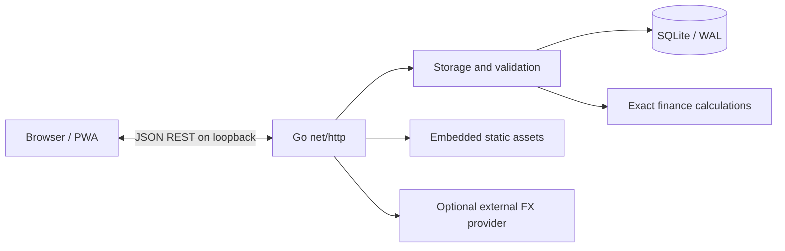

# Architecture

[← Project](../README.md) · [Developer guide](DEVELOPMENT.md) · [HTTP API](API.md)

Capital Tracker is a **local-first** monthly net-worth application. It is not a per-transaction ledger. The Go executable starts a loopback HTTP server, opens a browser (unless disabled), serves embedded web assets and persists user data in SQLite. The frontend consists of plain HTML, CSS, and JavaScript ES modules. Node.js is used for development tests and formatting only, not in the installed app.

## Request and data flow

The app does not run a background cloud service. The optional FX rate lookup is explicitly requested by the user; balances and account names are not included in the provider request. The `--demo` flag points to isolated sample data rather than the real financial database.

## Code map

| Path | Responsibility |
| --- | --- |
| `cmd/capital-tracker/` | CLI, `--demo`, backup, loopback listener, launch browser, OS lock, graceful shutdown |
| `internal/httpapi/` | REST routes, validation/error mapping, static serving, same-origin and Host checks |
| `internal/storage/` | SQLite access, migrations, transactions, account/group/month persistence, export/import |
| `internal/finance/` | Integer minor units, scaled FX rates, exact rational totals and rounding |
| `internal/demo/` | Embedded fictional fixture, isolated sample database |
| `internal/buildinfo/` | Authoritative version and embedded commit SHA |
| `web/embed.go` | Bundled frontend resources embedded in Go binary at compile time |
| `web/js/app.js` | Browser event wiring and app bootstrap |
| `web/js/state.js` and `router.js` | UI state, navigation and refresh |
| `web/js/{accounts,monthly,dashboard,settings}.js` | Screen rendering |
| `web/js/*-actions.js` | Async mutation handlers and dialogs |
| `web/js/{api,format,ui,numbers,messages}.js` | Shared API, formatting, UI and message utilities |
| `web/css/app.css`, `web/sw.js` | Responsive styling, network-first PWA cache |
| `tests/` | Node unit tests, release tests and Playwright end-to-end tests |

The browser is an **untrusted client**. All persisted values and state transitions are validated in Go before SQLite writes. Browser-side validation is for user experience only.

## Model and invariants

- Accounts each have a single currency and one or more active periods. Archiving requires an explicit zero balance in the latest saved month and does not destroy historical balances. Archive/restore must not silently alter past saved months.
- Groups organize accounts and can be moved or renamed; group membership is **current**, not recorded per month. Moving an account can change historical *group subtotals* but never historical *net worth*.
- Monthly balances use `(account_id, YYYY-MM, amount_minor)` with integer minor units; an absent row means *unknown*, not zero.
- FX rates are per-month and stored as fixed-point integer values scaled by `10^8` (not IEEE floating point). EUR is the reporting base; rate interpretation is **1 EUR = X foreign units**.
- A month is complete only when all active accounts have saved balances and every required non-EUR FX rate is present. A month can be saved partially.
- Monetary totals use `math/big` rational arithmetic in `internal/finance` and round **once** to EUR cents, ties away from zero. Never replace this with JavaScript `Number` or Go `float64` arithmetic for persisted amounts.
- `PUT /api/months/{month}` replaces the supplied month's balances and rates in a transaction. Omitted entries are intentionally removed; frontends must not treat missing entries as zero.
- Data import/clear actions are destructive, explicitly confirmed, and run transactionally. Keep export/backup instructions and tests aligned with these behaviors.

## SQLite and schema changes

`internal/storage/store.go` opens SQLite through `database/sql` using the pure-Go driver, enables foreign keys and WAL, and restricts it to one connection. Mutations are serialized and use transactions for atomicity. Migrations are embedded from `internal/storage/migrations/NNN_name.sql`; numbering must be contiguous. Existing databases receive a pre-migration backup, while an unknown or newer schema is rejected.

To change the schema, add the next numbered migration. Never edit an already-released migration. Extend the relevant storage tests, API tests, and the portable JSON schema/compatibility rules when necessary.

## Security boundaries

- The listener binds `127.0.0.1`, not the LAN. `internal/httpapi/security.go` restricts allowed `Host`, checks `Origin`/fetch metadata on mutations and requires the `X-Capital-Tracker: 1` header.
- Browsers receive a restrictive Content Security Policy, `X-Frame-Options`, `nosniff`, and no-referrer headers.
- In local mode the service worker caches **static** assets only; API responses are not cached. Asset requests are network-first. With authentication enabled, a standalone server-rendered sign-in page gates the application HTML and assets as well as financial APIs. A network-only service worker removes old static caches so a cached application page cannot bypass the sign-in screen.
- The local SQLite file and JSON exports contain sensitive financial information. They are not encrypted by Capital Tracker; use OS/disk protection and safe backups.

For endpoint details, see [HTTP API](API.md). For commands, tests and packaging, see [Developer guide](DEVELOPMENT.md).
