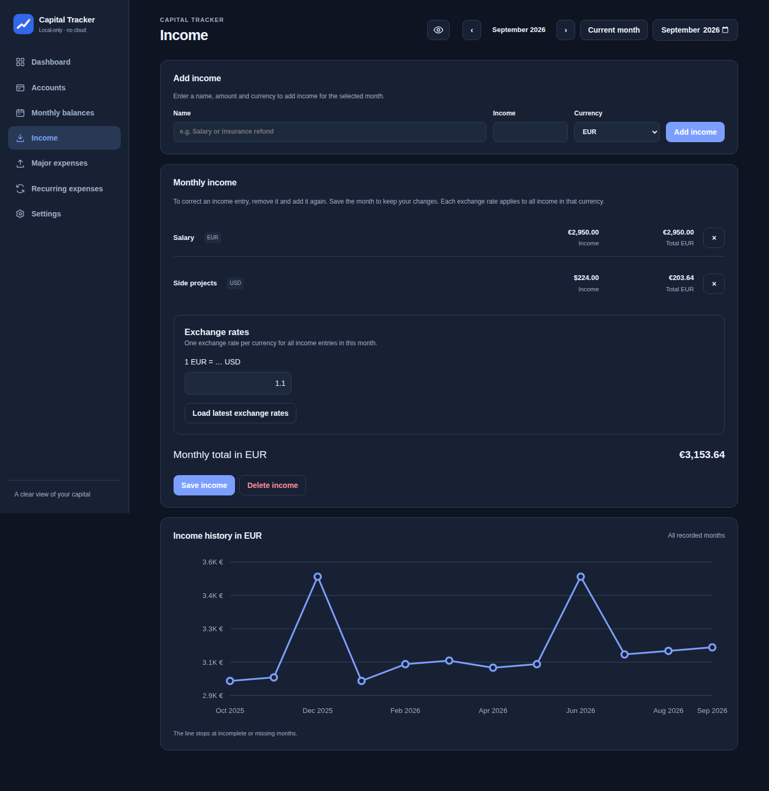
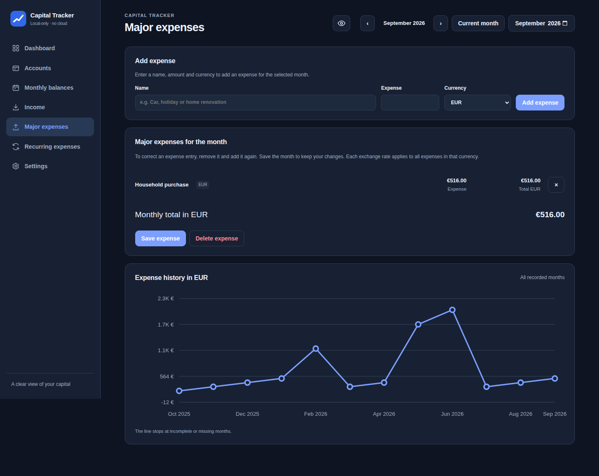
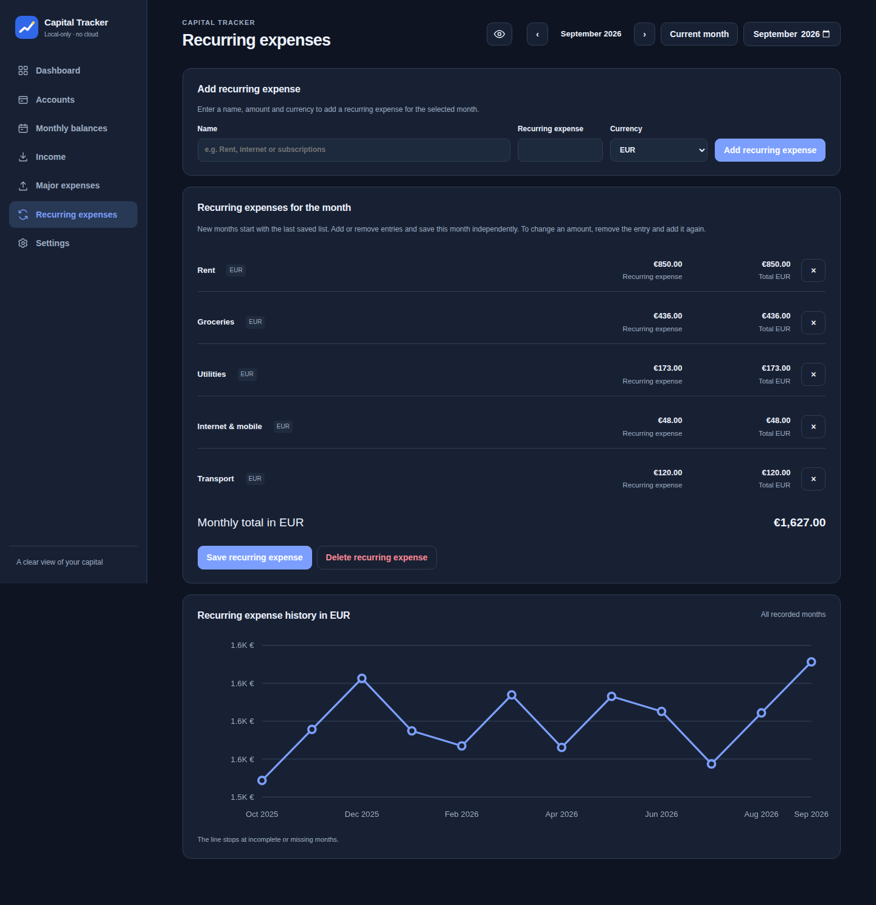
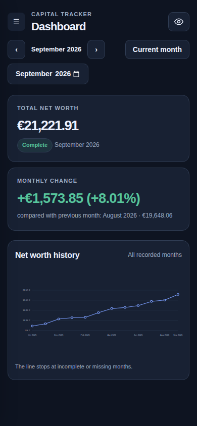

# Capital Tracker — Screenshot Gallery

[← Back to the project](../../README.md)

All eight screenshots are **real Chromium captures of Capital Tracker in Dark mode**, using the isolated, fictional 12-month demo. They are not generated mockups and contain no private financial records. The same demo includes populated account balances, income, major expenses and recurring expenses.

**Click or tap an image to open the original full-resolution PNG.** The two mobile captures use a 390-pixel browser viewport.

## 1. Dashboard

<a href="https://raw.githubusercontent.com/perevozchiko/capital-tracker/master/docs/screenshots/dashboard.png">
  
</a>

EUR capital total, previous-month comparison and history chart. [Full-size PNG](https://raw.githubusercontent.com/perevozchiko/capital-tracker/master/docs/screenshots/dashboard.png).

## 2. Monthly balances

<a href="https://raw.githubusercontent.com/perevozchiko/capital-tracker/master/docs/screenshots/monthly-balances.png">
  
</a>

Grouped account balances, previous-month differences and exchange-rate editor. [Full-size PNG](https://raw.githubusercontent.com/perevozchiko/capital-tracker/master/docs/screenshots/monthly-balances.png).

## 3. Accounts and groups

<a href="https://raw.githubusercontent.com/perevozchiko/capital-tracker/master/docs/screenshots/accounts.png">
  
</a>

Collapsible account groups, current EUR subtotals and account management. [Full-size PNG](https://raw.githubusercontent.com/perevozchiko/capital-tracker/master/docs/screenshots/accounts.png).

## 4. Income

<a href="https://raw.githubusercontent.com/perevozchiko/capital-tracker/master/docs/screenshots/income.png">
  
</a>

Named salary and other income entries, their currencies, EUR total and monthly history. [Full-size PNG](https://raw.githubusercontent.com/perevozchiko/capital-tracker/master/docs/screenshots/income.png).

## 5. Major expenses

<a href="https://raw.githubusercontent.com/perevozchiko/capital-tracker/master/docs/screenshots/major-expenses.png">
  
</a>

Named occasional purchases, EUR totals and large-expense history. [Full-size PNG](https://raw.githubusercontent.com/perevozchiko/capital-tracker/master/docs/screenshots/major-expenses.png).

## 6. Recurring expenses

<a href="https://raw.githubusercontent.com/perevozchiko/capital-tracker/master/docs/screenshots/recurring-expenses.png">
  
</a>

Regular monthly costs and their independent month-end history; unsaved months inherit the previous saved snapshot. [Full-size PNG](https://raw.githubusercontent.com/perevozchiko/capital-tracker/master/docs/screenshots/recurring-expenses.png).

## 7. Mobile dashboard

<a href="https://raw.githubusercontent.com/perevozchiko/capital-tracker/master/docs/screenshots/mobile-dashboard.png">
  
</a>

The real dashboard in a 390-pixel phone viewport. [Full-size PNG](https://raw.githubusercontent.com/perevozchiko/capital-tracker/master/docs/screenshots/mobile-dashboard.png).

## 8. Mobile balances

<a href="https://raw.githubusercontent.com/perevozchiko/capital-tracker/master/docs/screenshots/mobile-balances.png">
  
</a>

Grouped balance editor in a 390-pixel phone viewport. [Full-size PNG](https://raw.githubusercontent.com/perevozchiko/capital-tracker/master/docs/screenshots/mobile-balances.png).

## Regenerate from the actual app

Run from the repository root, using Python Playwright and Chromium:

```sh
python3 -m pip install playwright
python3 -m playwright install chromium
python3 scripts/capture-demo-screenshots.py
```

The script starts a newly built Go app with `--demo`, uses a **fresh temporary data directory**, chooses Dark in the app's Settings UI and captures desktop and mobile pages from Chromium. It never opens your regular database. The demo fixture in `internal/demo/sample-2025-2026.json` is also available to normal `--demo` users.

Alternatively, run **Actions → Capture demo screenshots → Run workflow** on `master`. The workflow commits refreshed PNGs only when the actual captures change.

**GitHub limitation:** repository Markdown does not run a custom zoom/lightbox viewer. Images link to the original file, where your browser's image viewer can zoom in.
