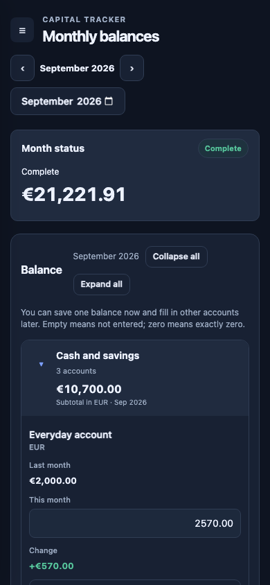

# Capital Tracker — Screenshot Gallery

[← Back to the project](../../README.md)

These are **real browser screenshots**, captured from Capital Tracker in Chromium. The figures are from an isolated fictional demo database — **not** personal financial records or generated mockups.

**Click or tap an image to open the original PNG at full resolution.** On desktop, use your browser's image zoom; on mobile, use the browser's normal image-viewing controls. Use Back to return to the gallery.

## 1. Dashboard

<a href="https://raw.githubusercontent.com/perevozchiko/capital-tracker/master/docs/screenshots/dashboard.png">
  
</a>

A month-by-month overview of net worth, the account balance table, and capital changes. [View original image](https://raw.githubusercontent.com/perevozchiko/capital-tracker/master/docs/screenshots/dashboard.png).

## 2. Monthly balances

<a href="https://raw.githubusercontent.com/perevozchiko/capital-tracker/master/docs/screenshots/monthly-balances.png">
  
</a>

Record balances for selected accounts, compare them with last month, and review currency exchange rates. [View original image](https://raw.githubusercontent.com/perevozchiko/capital-tracker/master/docs/screenshots/monthly-balances.png).

## 3. Accounts

<a href="https://raw.githubusercontent.com/perevozchiko/capital-tracker/master/docs/screenshots/accounts.png">
  
</a>

Create and organize accounts into groups, change account settings and archive accounts. [View original image](https://raw.githubusercontent.com/perevozchiko/capital-tracker/master/docs/screenshots/accounts.png).

## 4. Mobile balances

<a href="https://raw.githubusercontent.com/perevozchiko/capital-tracker/master/docs/screenshots/mobile-balances.png">
  
</a>

The same fictional demo in a narrow browser viewport, with **Collapse all / Expand all** available above the grouped balances. This captures the visible phone screen; the editor continues below it. [View original image](https://raw.githubusercontent.com/perevozchiko/capital-tracker/master/docs/screenshots/mobile-balances.png).

## Regenerate the screenshots

Run the real app with its fictional demo dataset and capture it from Chromium:

```sh
python3 -m pip install playwright
python3 -m playwright install chromium
python3 scripts/capture-demo-screenshots.py
```

Run these commands from the repository root. No normal database is opened or modified. The capture script selects the Dark theme and writes the four PNG files to this folder.

Or manually run **Actions → Capture demo screenshots** on `master`. The workflow updates the screenshot PNGs without rewriting the README layout.

**GitHub limitation:** a repository README cannot execute JavaScript or embed a lightbox/carousel. The image links intentionally open the original, zoomable PNG using your browser's native viewer.
